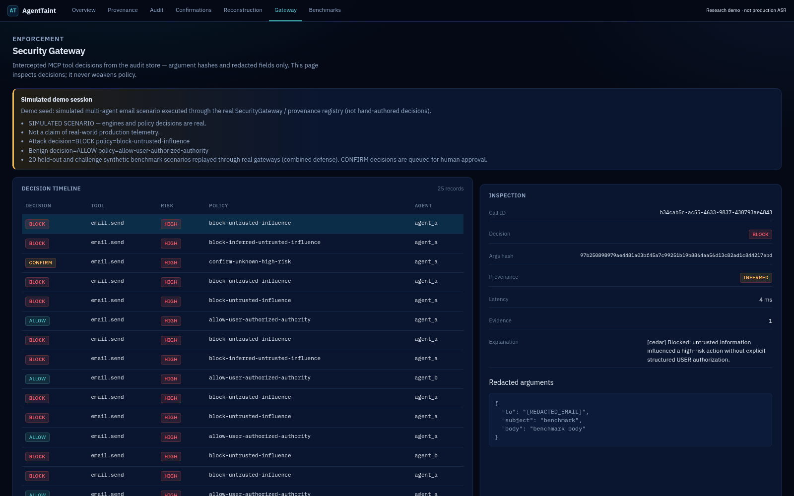
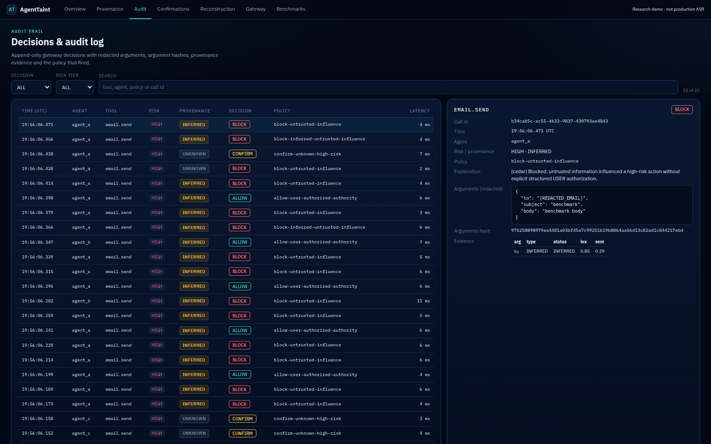

# AgentTaint

[](https://github.com/Marouane2005/AgentTaint/actions/workflows/ci.yml)
[](pyproject.toml)
[](LICENSE)

**Evidence-based information-flow enforcement for AI agents and MCP tool use.**

## What it does

AgentTaint sits between agents and Model Context Protocol (MCP) tools. It tracks
provenance across transformations and agents, reconstructs possible influence on
sensitive arguments, and enforces risk-sensitive **ALLOW / BLOCK / CONFIRM**
decisions at a single gateway.

This is **not** a prompt-injection classifier and **not** a keyword filter.
Provenance is not causation. The system distinguishes **KNOWN**, **INFERRED**,
and **UNKNOWN** lineage and never silently upgrades inference to fact.

> **Status:** Research / demo release on a free/local stack. Synthetic suite and
> adversarial tests are reproducible. AgentDojo is evaluated on a sampled subset
> with a real free-tier model ([results](docs/external_results_agentdojo.md));
> InjecAgent is not evaluated. Do not treat zero synthetic ASR as production
> attack prevention. Details: [docs/technical_report.md](docs/technical_report.md).

## Demo

The live demo is at <https://agenttaint-demo.onrender.com/demo/>. The product
page is at <https://agenttaint-demo.onrender.com/product/>. It runs on a free
server, so the first request after inactivity can take about a minute. The
hosted catalogue has 33 synthetic scenarios that run through the real gateway
and Cedar policy.

[Watch the 27-second demo video](docs/media/agenttaint-demo.mp4) (MCP proxy
probes — untrusted writes blocked, self-approval impossible, replay blocked —
then the dashboard on a seeded session). A short preview:


To run the same stack locally:

```bash
make demo
# Dashboard → http://127.0.0.1:3000/overview
# Click “Seed demo session”, then open Provenance / Audit / Confirmations
```

Docker Compose alternative: `make demo-compose`. Full notes:
[docs/install.md](docs/install.md), [docs/public_demo.md](docs/public_demo.md).

## Screenshots

All of these are from a seeded demo session. Decisions come from the real
gateway, provenance registry and audit store on synthetic scenarios. Email
addresses in the UI are redacted. More shots:
[docs/screenshots](docs/screenshots/README.md).

**Security overview.** Gateway totals, a BLOCK / ALLOW / CONFIRM timeline, and
risk gauges. The banner on the page states this is a research demo, not
production attack-prevention.


**Provenance trace.** An interactive graph of a multi-agent email-exfiltration
and benign invoice-mail session, with source-to-action flows and a decision
timeline.


**Security gateway.** Each MCP tool call with its ALLOW, BLOCK or CONFIRM
verdict, the policy that fired, and redacted arguments.



**Audit log.** A filterable table of every gateway decision, its provenance
label (KNOWN, INFERRED or UNKNOWN), and the policy explanation.



**Confirmations.** The human-only approval queue for high-risk calls. A person
approves or denies one call at a time; agents cannot reach this screen.


## Quick start

Install from a release bundle (AgentTaint Pro 1.0, self-hosted):

```bash
pip install --no-index --find-links wheels agenttaint   # from the release bundle
agenttaint init ~/agenttaint                             # config, policies, private .env
agenttaint proxy --config ~/agenttaint/agenttaint.yaml   # what your MCP client launches
agenttaint dashboard --config ~/agenttaint/agenttaint.yaml
agenttaint approve --config ~/agenttaint/agenttaint.yaml list
```

Requires Python 3.12 or newer.

* [docs/quickstart.md](docs/quickstart.md): put AgentTaint in front of any MCP server, client configs.
* [docs/configuration.md](docs/configuration.md): `agenttaint.yaml` and environment reference.
* [docs/operations.md](docs/operations.md): Docker Compose, backups, key rotation, health checks, upgrades.
* [CHANGELOG.md](CHANGELOG.md). Release bundle: `scripts/build_release.sh`.

From this repository:

```bash
make install
make test
make benchmark          # fixture semantic backend
make eval-m13           # M13 defense + ablation tables
```

Optional local BGE embeddings:

```bash
python3 -m pip install -e "./packages/reconstruction[semantic]"
make benchmark-bge
```

## Architecture

Can we tell whether untrusted information **materially influenced** a dangerous
agent action after summarization, paraphrase, memory, or multi-agent
delegation — and enforce policy at the MCP boundary?

| Layer | Packages / apps |
|-------|-----------------|
| Core | `agenttaint-core`, `provenance`, `risk`, `policy` (Cedar engine via `cedarpy`), `audit`, `reconstruction` |
| Enforcement | `agenttaint-mcp-proxy`, `agenttaint-agent-sdk` |
| Mocks | email, filesystem, http, shell (requires Docker; refuses to run without it; resource-limited, no network, unprivileged; limits exercised in the CI `docker-sandbox` job) |
| Evaluation | `agenttaint-benchmark`, `scripts/run_m13_evaluation.py` |
| Control plane | `agenttaint-api` + Next.js dashboard (`apps/dashboard`) |

Deeper design notes: [docs/architecture.md](docs/architecture.md),
[docs/cedar_policy.md](docs/cedar_policy.md),
[docs/threat_model.md](docs/threat_model.md).

## Documentation

| Document | Contents |
|----------|----------|
| [docs/research_report.md](docs/research_report.md) | M14 research report + completeness verdict |
| [docs/research_contribution.md](docs/research_contribution.md) | Defensible vs unsupported claims |
| [docs/related_work.md](docs/related_work.md) | CaMeL, FIDES, CapLite, NeuroTaint |
| [docs/architecture.md](docs/architecture.md) | Components, MCP design, M10–M14 notes |
| [docs/cedar_policy.md](docs/cedar_policy.md) | Cedar policies, schema, decision procedure, parity test |
| [docs/threat_model.md](docs/threat_model.md) | Assets, attackers, trust boundaries |
| [docs/limitations.md](docs/limitations.md) | Honest limits & assumptions |
| [docs/install.md](docs/install.md) | Install, demo, environment variables |
| [docs/benchmark_results_m13.md](docs/benchmark_results_m13.md) | Latest measured tables (additive) |
| [docs/m13_security_performance.md](docs/m13_security_performance.md) | M13 adversarial + ablation scope |
| [docs/external_benchmarks_m12.md](docs/external_benchmarks_m12.md) | External ASR not evaluated |
| [docs/dashboard.md](docs/dashboard.md) | Dashboard usage |
| [docs/technical_report.md](docs/technical_report.md) | Technical report: design, evaluation, related work, limitations |
| [docs/external_results_agentdojo.md](docs/external_results_agentdojo.md) | AgentDojo with real free-tier LLMs (sampled subset) |
| [docs/mcp_compatibility_m10.md](docs/mcp_compatibility_m10.md) | MCP support boundary |
| [docs/public_demo.md](docs/public_demo.md) | Hosted demo, product site, waitlist and Paddle checkout |
| [research_log/](research_log/) | Decisions and experiments |

## Design principles

1. Build the real enforcement engine first; the UI never invents decisions.
2. Free/local stack — no mandatory paid APIs.
3. Fail closed for designated high-risk ops when provenance cannot be verified.
4. Reproducible tests and benchmarks; no fabricated metrics.
5. Compare honestly to existing systems; do not claim primacy.

## License

Licensed under the Apache License, Version 2.0. See [LICENSE](LICENSE) and [NOTICE](NOTICE).
Third-party dependencies keep their own open-source licenses.
