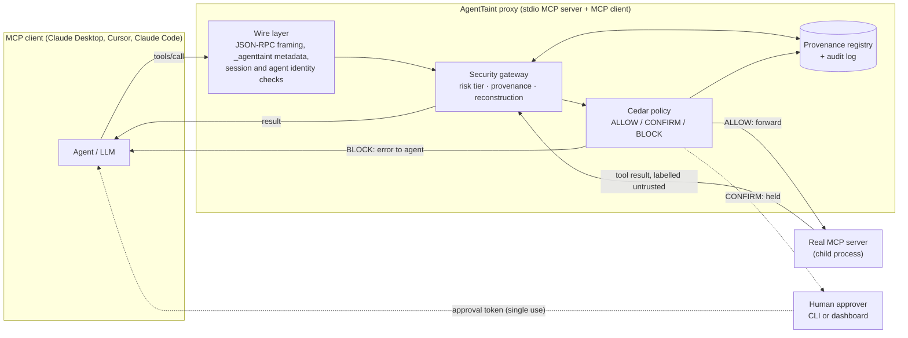
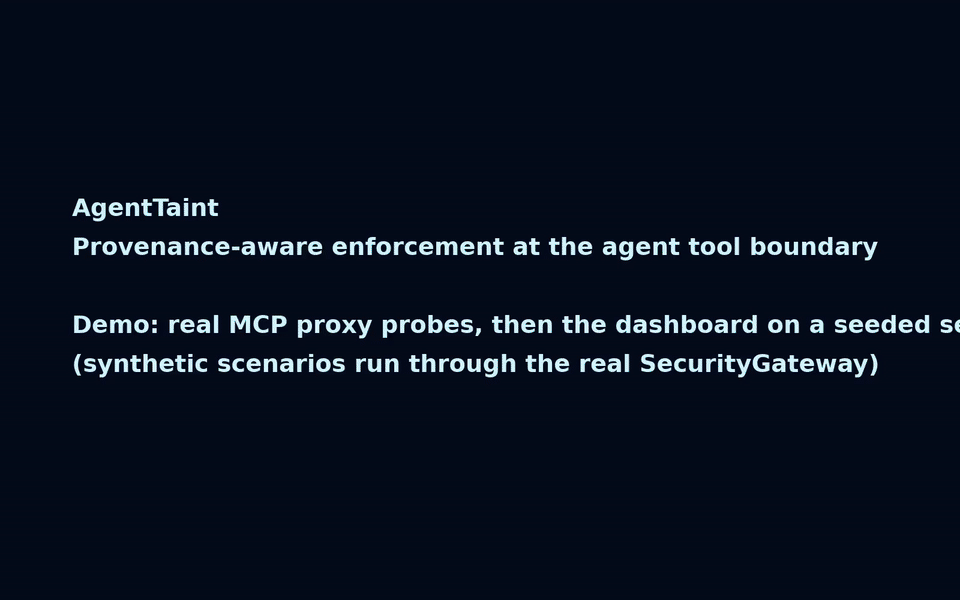

# AgentTaint

[](https://github.com/Marouane2005/AgentTaint/actions/workflows/ci.yml)
[](pyproject.toml)
[](LICENSE)

**A provenance-aware firewall for MCP tool calls.** AgentTaint sits between an
agent and its MCP servers and decides **ALLOW / CONFIRM / BLOCK** for each tool
call from where its sensitive arguments (recipient, URL, path, command) came
from. If untrusted content, such as a web page, an email or a file the agent read,
influenced the destination of a high-risk action, the call is stopped or held for
a human.

It is not a prompt-injection classifier and not a keyword filter. Lineage is
labelled **KNOWN**, **INFERRED** or **UNKNOWN**, and inference is never silently
promoted to fact.

> **Status:** research release. The numbers below are reproducible and come from
> committed reports, but the benchmark is synthetic and a zero attack success rate
> on it is not a guarantee of production protection. See [limitations](docs/limitations.md).

## How it works



The proxy is a stdio MCP server to the client and an MCP client to the real
server, so no agent or server code changes. Every result the backend returns is
recorded as an untrusted span. When the agent then calls a high-risk tool, the
gateway checks whether the sensitive arguments trace back to those spans: through
declared lineage, or through reconstruction (lexical, structural and semantic
evidence) when the agent does not declare it. Semantic similarity alone never
promotes an email, URL, path or shell command to INFERRED. The decision is made by
a Cedar policy, with a Python reference implementation checked against it
exhaustively in `tests/unit/test_cedar_policy_parity.py`.

## Results

Every figure below is copied from a committed report. Nothing is estimated.

**Held-out test split** (synthetic scenarios, seed 2120, 68 scenarios, fixture
semantic backend; report
[`benchmarks/reports/report_test_fixture_480f0c5f.md`](benchmarks/reports/report_test_fixture_480f0c5f.md)):

| defense | attack success rate | benign blocked | benign sent to CONFIRM | median / p95 latency |
|---|---|---|---|---|
| undefended | 1.000 | 0.000 | 0.000 | 3.27 / 4.93 ms |
| coarse taint (block anything tainted) | 0.000 | 0.296 | 0.000 | 1.63 / 3.55 ms |
| **AgentTaint (combined)** | **0.000** | **0.000** | **0.000** | 9.02 / 14.19 ms |

How to read it:

* Attack success rate counts attacks that were **ALLOWed**. An attack answered
  with **BLOCK** (stopped outright) or **CONFIRM** (held for a human) does not
  count as a success; a CONFIRM only protects if the human declines. The reports
  do not split the test-split attacks into BLOCK vs CONFIRM; the four challenge
  scenarios in [`docs/benchmark_results_m13.md`](docs/benchmark_results_m13.md)
  show both outcomes (for example `block-untrusted-influence` and
  `confirm-unknown-high-risk`).
* Of the benign scenarios, **0% were blocked** by AgentTaint, against 29.6% for
  the coarse-taint baseline. No benign call was sent to CONFIRM either.
* Detection recall on attack scenarios is 0.976 with precision 1.000 (the
  adaptive-split family is the weak spot: recall 0.333 on 3 scenarios).
* With local BGE embeddings (BAAI/bge-small-en-v1.5 on CPU, report
  [`report_test_bge_30821f52.md`](benchmarks/reports/report_test_bge_30821f52.md)): ASR 0.000,
  benign blocked 0.000, precision 1.000, recall 1.000, latency 72.78 / 181.43 ms
  (median / p95).
* Before/after numbers for the 2026-11 hardening, measured against the previous
  release on the same machine, are in
  [docs/benchmark_results_hardening.md](docs/benchmark_results_hardening.md).

**AgentDojo** (v1.2.1, sampled subset: 4 suites, 5 user tasks and 2 injection
tasks each, one free-tier model, `mercury-3`; details in
[docs/external_results_agentdojo.md](docs/external_results_agentdojo.md)):

| defense | utility (n=20) | ASR, 95% CI (n=40) | tool-action ASR (n=35) | BLOCKed calls | CONFIRMs |
|---|---|---|---|---|---|
| undefended | 0.850 | 0.075 (0.03–0.20) | 0.000 | 0 | 0 |
| AgentTaint, CONFIRM = declined | 0.350 | 0.050 (0.01–0.17) | 0.000 | 39 | 53 |
| AgentTaint, CONFIRM = approved | 0.500 | 0.075 (0.03–0.20) | 0.000 | 71 | 18 |

This run does **not** show a security gain: the model already resisted every
tool-action injection undefended (0/35), and the only successful attacks put the
injected text into the answer, which a tool-call firewall does not filter. It
does show the cost: utility drops from 0.85 to 0.35 to 0.50, mostly where tasks
legitimately take recipients from content the agent just read. Samples are small
with wide confidence intervals.

The AgentDojo run was produced **before** the reconstruction and proxy hardening in
the [changelog](CHANGELOG.md) and has not been re-run since (it needs a hosted model).

## Quick start

```bash
# 1. Install
git clone https://github.com/Marouane2005/AgentTaint.git && cd AgentTaint
python3 -m venv .venv && source .venv/bin/activate && make install

# 2. Wrap your MCP server (writes config, policies and a private .env)
.venv/bin/agenttaint init ~/agenttaint --backend "npx -y @modelcontextprotocol/server-filesystem $HOME/projects"

# 3. Print the config for your client and paste it in
.venv/bin/agenttaint connect claude-desktop --config ~/agenttaint/agenttaint.yaml   # or: cursor, claude-code
```

Then restart the client and run `agenttaint log` to see each decision. Held calls
are approved with `agenttaint approve`. The full guide, with working
Claude Desktop, Cursor and Claude Code configs, is in
[docs/quickstart.md](docs/quickstart.md). Requires Python 3.12+. `make install` installs every
package from this checkout in editable mode (the `agenttaint` package pins its sibling packages,
so installing the CLI alone would look for them on PyPI).

## Demo

The live demo is at <https://agenttaint-demo.onrender.com/demo/>. The product
page is at <https://agenttaint-demo.onrender.com/product/>. It runs on a free
server, so the first request after inactivity can take about a minute. The
hosted catalogue has 33 synthetic scenarios that run through the real gateway
and Cedar policy.

[Watch the 27-second demo video](docs/media/agenttaint-demo.mp4) (MCP proxy
probes — untrusted writes blocked, self-approval impossible, replay blocked —
then the dashboard on a seeded session). A short preview:



To run the same stack locally:

```bash
make demo
# Dashboard → http://127.0.0.1:3000/overview
# Click “Seed demo session”, then open Provenance / Audit / Confirmations
```

Docker Compose alternative: `make demo-compose`. Full notes:
[docs/install.md](docs/install.md), [docs/public_demo.md](docs/public_demo.md).

## Development

```bash
make install
make test
make benchmark          # fixture semantic backend
make benchmark-bge      # needs: pip install -e "./packages/reconstruction[semantic]"
make eval-m13           # defense + ablation tables
make dashboard-install && make dashboard-test && make dashboard-lint
```

## Architecture

| Layer | Packages / apps |
|-------|-----------------|
| Core | `agenttaint-core`, `provenance`, `risk`, `policy` (Cedar via `cedarpy`), `audit`, `reconstruction` |
| Enforcement | `agenttaint-mcp-proxy`, `agenttaint-agent-sdk` |
| CLI | `agenttaint-cli` (`init`, `connect`, `doctor`, `proxy`, `approve`, `log`, `dashboard`) |
| Evaluation | `agenttaint-benchmark`, `scripts/run_m13_evaluation.py` |
| Control plane | `agenttaint-api` and the Next.js dashboard (`apps/dashboard`) |

More: [docs/architecture.md](docs/architecture.md), [docs/cedar_policy.md](docs/cedar_policy.md),
[docs/threat_model.md](docs/threat_model.md).

## Documentation

| Document | Contents |
|----------|----------|
| [docs/research_report.md](docs/research_report.md) | M14 research report + completeness verdict |
| [docs/research_contribution.md](docs/research_contribution.md) | Defensible vs unsupported claims |
| [docs/related_work.md](docs/related_work.md) | CaMeL, FIDES, CapLite, NeuroTaint |
| [docs/architecture.md](docs/architecture.md) | Components, MCP design, M10–M14 notes |
| [docs/cedar_policy.md](docs/cedar_policy.md) | Cedar policies, schema, decision procedure, parity test |
| [docs/threat_model.md](docs/threat_model.md) | Assets, attackers, trust boundaries |
| [docs/limitations.md](docs/limitations.md) | Honest limits & assumptions |
| [docs/install.md](docs/install.md) | Install, demo, environment variables |
| [docs/benchmark_results_m13.md](docs/benchmark_results_m13.md) | Latest measured tables (additive) |
| [docs/benchmark_results_hardening.md](docs/benchmark_results_hardening.md) | Security fixes and before/after measurements for the 2026-11 hardening |
| [docs/m13_security_performance.md](docs/m13_security_performance.md) | M13 adversarial + ablation scope |
| [docs/external_benchmarks_m12.md](docs/external_benchmarks_m12.md) | External ASR not evaluated |
| [docs/dashboard.md](docs/dashboard.md) | Dashboard usage |
| [docs/technical_report.md](docs/technical_report.md) | Technical report: design, evaluation, related work, limitations |
| [docs/external_results_agentdojo.md](docs/external_results_agentdojo.md) | AgentDojo with real free-tier LLMs (sampled subset) |
| [docs/mcp_compatibility_m10.md](docs/mcp_compatibility_m10.md) | MCP support boundary |
| [docs/public_demo.md](docs/public_demo.md) | Hosted demo, product site and release-updates waitlist |
| [research_log/](research_log/) | Decisions and experiments |

## Design principles

1. Build the real enforcement engine first; the UI never invents decisions.
2. Free/local stack: no mandatory paid APIs.
3. Fail closed for designated high-risk operations when provenance cannot be verified.
4. Reproducible tests and benchmarks; no fabricated metrics.
5. Compare honestly to existing systems; do not claim primacy.

## License

Licensed under the Apache License, Version 2.0. See [LICENSE](LICENSE) and [NOTICE](NOTICE).
Third-party dependencies keep their own licenses. To report a vulnerability, see
[SECURITY.md](SECURITY.md).
