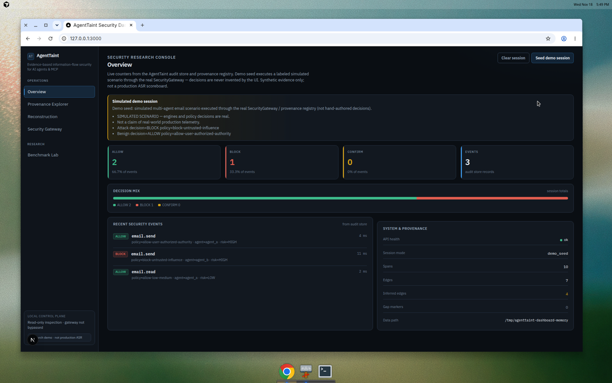

# Dashboard screenshots

Captured from the local research demo (`make demo` / `make api` + `make dashboard`).

| File | View |
|------|------|
| `overview-seeded.png` | Overview after Seed demo session |
| `provenance.png` | Provenance Explorer graph |
| `gateway.png` | Security Gateway decisions |
| `benchmarks.png` | Benchmark Lab tables |

These images document the control-plane UI. They are **not** evidence of
production attack prevention.
